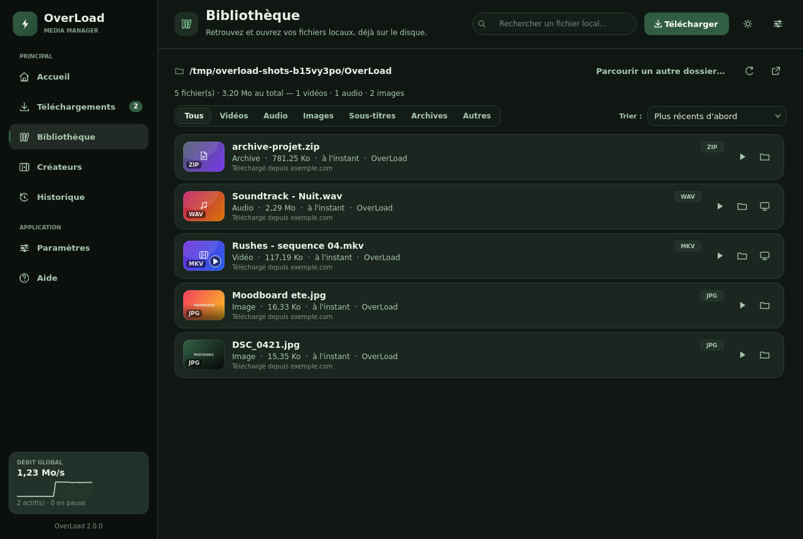
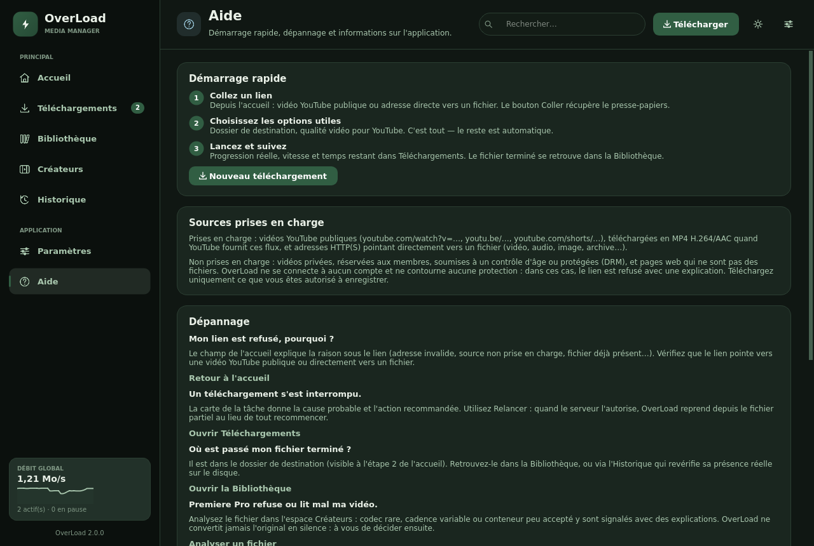

# OverLoad — identité visuelle et organisation (v2.0)

Cette page documente le système de design et l'organisation de l'application
native `OverLoad.exe` (PySide6 / Qt Widgets) à partir de la version 2.0.
Les captures sont générées automatiquement par
`python scripts/render_screenshots.py` et servent de référence pour toute
évolution future.

> **Principe directeur.** OverX doit impressionner quand on le découvre ;
> OverLoad doit impressionner quand on l'**utilise** : navigation stable,
> statuts sans ambiguïté, fichiers toujours retrouvables, aucun effet
> gratuit. Même famille visuelle (sombre, élégante, vert forêt naturel),
> organisation entièrement repensée.


---

## 1. Direction visuelle

Une seule palette, déclinée partout : fenêtre native, programme
d'installation, icône et interface web de secours.

| Rôle | Valeur | Usage |
| --- | --- | --- |
| Fond principal | `#101713` | Vert-noir profond, confortable en usage prolongé |
| Panneaux | `#1A261F` | Navigation, zones de contenu, menus, cartes |
| Vert forêt | `#315E43` | Actions principales, éléments sélectionnés, boutons, progression |
| Vert sauge | `#A9C7AE` | Détails lumineux, accents graphiques, texte secondaire, texte d'accent en sombre |

Constantes de référence : `FOREST_NIGHT`, `FOREST_PANEL`, `FOREST_BRAND`,
`FOREST_SAGE` dans `src/overload/ui/theme.py`. Toutes les autres teintes
(surfaces secondaires `#223129`, champs `#131C16`, bordures `#2B3E32`,
texte crème `#EAF1E8`…) en sont dérivées et centralisées au même endroit.

**Pourquoi un `accent_text` distinct ?** Le vert forêt `#315E43` est parfait
en *surface* (bouton avec texte crème ≈ 6,4:1), mais trop sombre en *texte*
sur `#101713`. Le design distingue donc :

- `accent` (`#315E43`) : remplissages — boutons primaires, barre de
  progression, pastilles compteur, sélection ;
- `accent_text` (`#A9C7AE` en sombre, `#315E43` en clair) : liens, libellés
  actifs, icônes teintées accent, anneaux de focus.

### Couleurs d'état (volontairement distinctes de l'accent)

| État | Sombre | Clair | Signification |
| --- | --- | --- | --- |
| En cours | sauge sur fond sauge doux | forêt | transfert actif |
| Terminé | `#7FC98F` | `#2F7D4A` | fichier complet **et vérifié** |
| Avertissement | `#E0B96B` | `#8F640E` | vérification, nouvelle tentative, connexion lente |
| Erreur / interrompu | `#E88E7B` | `#AE3727` | action requise |
| Information / pause | `#93BFD0` | `#2C6577` | état neutre informatif |

### Thème clair et accents

Le thème clair « jour en forêt » conserve la même hiérarchie : fond
`#EEF3EB`, surfaces `#FCFDF9`, texte vert-noir `#101713`, vert forêt en
accent et en texte d'accent. Six accents alternatifs (violet, bleu, cyan,
émeraude, ambre, rose) restent disponibles dans Paramètres → Apparence ;
le socle vert-noir ne change pas.


### Typographie, espacements

- Manrope / Inter si disponibles, sinon Segoe UI Variable (Windows).
- Échelle d'interface Compact / Normal / Grand appliquée à tout le QSS et
  aux composants dessinés.
- Rayons : 20 px (héro), 16 px (panneaux), 14–15 px (cartes), 10 px
  (champs et boutons), 8 px (pilules d'état).

## 2. Organisation de l'application

Barre latérale fixe à gauche, zone de travail principale à droite,
barre supérieure (titre de page, recherche contextuelle, action
*Télécharger*, thème, paramètres). L'utilisateur sait toujours où il est
et où retrouver ses fichiers.

```
OverLoad — MEDIA MANAGER
PRINCIPAL     Accueil · Téléchargements (pastille compteur) ·
              Bibliothèque · Créateurs · Historique
APPLICATION   Paramètres · Aide
```

| Section | Rôle |
| --- | --- |
| **Accueil** | Démarrer un téléchargement en 3 étapes, voir l'activité récente et la file |
| **Téléchargements** | Tâches en cours / en attente / en pause / en erreur, actions par statut |
| **Bibliothèque** | Retrouver, filtrer, ouvrir les fichiers **locaux** (lecture du disque) |
| **Espace Créateurs** | Hub d'outils explicatifs + onglets : projets, préparation, analyse, renommage, sous-titres, inventaire, profils |
| **Historique** | Téléchargements précédents (SQLite), présence sur disque revérifiée |
| **Paramètres** | Destination, apparence, comportement, options avancées |
| **Aide** | Démarrage rapide, sources prises en charge, dépannage, raccourcis, à propos |

Raccourcis : `Ctrl+L` (lien), `Ctrl+F` (recherche), `Ctrl+1`…`Ctrl+7`
(sections dans l'ordre de la barre latérale). Sous 1160 px, la barre
latérale se replie en rail d'icônes — la pastille compteur des
téléchargements reste visible. L'analyse multimédia (page séparée en 1.x)
vit désormais dans l'espace Créateurs ; les anciens accès y sont redirigés.

## 3. Nouveau téléchargement : trois étapes

Sur l'accueil, « Bienvenue dans OverLoad — Tout commence ici. » :

1. **Collez un lien** — champ large, bouton *Coller* explicite (en plus de
   `Ctrl+V`), sources prises en charge expliquées sous le champ
   (YouTube public, fichiers HTTP(S) directs ; pas de contournement de
   protection). La pastille ① se coche en vert dès que le lien est valide ;
   un lien refusé ou déjà présent est expliqué en toutes lettres.
2. **Choisissez les options utiles** — dossier de destination visible,
   modifiable et ouvrable ; qualité vidéo quand elle existe (YouTube
   uniquement, signalé comme sans effet sur les fichiers directs) ;
   accès au lot de liens.
3. **Lancez le téléchargement** — bouton principal, puis suivi détaillé
   dans Téléchargements.

**Progression honnête.** La barre et le pourcentage reflètent les données
réelles du moteur : le snapshot plafonne à 99,9 % tant que la tâche n'est
pas `COMPLETED`, l'interface tronque au lieu d'arrondir (99,9 % → « 99 % »),
et l'état « Vérification » affiche ce qui se passe au lieu d'un faux
100 %. `COMPLETED` n'arrive qu'après écriture complète et validation
(taille, puis FFprobe pour YouTube). Couvert par
`tests/unit/test_progress_honesty.py`.


Chaque tâche affiche un **statut explicite** (En cours, En attente, En
pause, Vérification, Terminé, Interrompu, Nouvelle tentative n/N, Annulé)
et uniquement les actions adaptées à ce statut : pause, reprise, relance,
annulation, **ouvrir le fichier**, afficher dans le dossier, retirer.
Les erreurs sont traduites en français actionnable
(`overload/ui/failure_text.py`), jamais un « Échec » nu.

## 4. Bibliothèque



Nouvelle page v2.0, adossée à `overload/library/scan.py` (lecture seule,
plafonnée, hors thread graphique) :

- dossier affiché = dossier de destination par défaut,
  « Parcourir un autre dossier… » pour la session, réanalyse manuelle ;
- statistiques réelles du dossier (nombre, taille totale, répartition) ;
- filtres Tous / Vidéos / Audio / Images / Sous-titres / Archives /
  Autres, tri (récents, nom, taille, type), recherche globale ;
- actions par fichier : **ouvrir** (application par défaut), afficher
  dans le dossier, **analyser** (ouvre l'outil Analyse des Créateurs
  prérempli) ; provenance « Téléchargé depuis … » quand l'historique la
  connaît ;
- les fichiers partiels (`.part`) ne sont jamais présentés comme des
  médias utilisables ; troncature et fichiers illisibles sont signalés.

## 5. Espace Créateurs


L'avantage différenciant d'OverLoad, rendu compréhensible :

- **Hub « Que voulez-vous faire ? »** : huit cartes (préparer un projet,
  mes projets, analyser un fichier, **vérifier pour Premiere Pro**,
  sous-titres et pistes, renommer par lots, inventaire et export, profils
  de montage). Chacune dit à quoi sert l'outil, les fichiers acceptés et
  ce qui va se passer *avant* de l'ouvrir ; le hub se réduit d'un clic.
- **Chaque onglet** commence par la même explication (utilité, entrées,
  effet), et chaque opération passe par un plan/aperçu validé.
- **Analyser / Premiere Pro** : conteneur, codecs, résolution, cadence,
  durée, pistes ; alertes de compatibilité signalées, aucune conversion
  silencieuse.
- **Préservation des originaux** : bandeau permanent et règle appliquée
  partout — jamais de déplacement, renommage, modification ou écrasement
  des fichiers source.

## 6. Historique et Aide




L'Historique devient une page de premier niveau (résumé terminé /
interrompu / annulé, filtre par statut, ouvrir fichier ou dossier,
retélécharger, retirer — sans jamais supprimer les fichiers). L'Aide
regroupe démarrage rapide, sources prises en charge et limites assumées,
dépannage avec renvois directs vers la bonne page, raccourcis et à-propos.

## 7. Organisation du code

| Fichier | Rôle |
| --- | --- |
| `ui/theme.py` | jetons v2.0 (dont `accent_text`), palettes sombre/claire, QSS complet |
| `ui/icons.py` | icônes vectorielles QPainter (+ `library`, `history`, `help`, `clipboard`, `layers`, `captions`, `scissors`) |
| `ui/components.py` | cartes, navigation (+ pastille compteur), `StepBadge`, `ToolCard`, `LibraryRow`, progression, vignettes |
| `ui/window.py` | fenêtre, 7 pages, parcours 3 étapes, hub Créateurs, bibliothèque, aide |
| `library/scan.py` | indexation lecture seule des fichiers locaux (testable sans Qt) |
| `core/paths.py` | dossiers + `open_file` (application par défaut) / `open_folder` (révéler) |
| `downloads/manager.py` | moteur ; progression plafonnée à 99,9 % avant validation |
| `ui/creators.py` | outils Créateurs (+ onglet Analyse, intros, `show_tool`) |
| `ui/analyzer.py` | analyse locale, préremplissage via `set_file()` |
| `ui/web/static/*` | interface web de secours, même palette v2.0 |
| `settings/store.py` | persistance thème, accent, échelle |

Captures régénérables : `python scripts/render_screenshots.py`
(dossier `docs/design/` : accueil, telechargements, bibliotheque,
historique, createurs, parametres, aide, theme-clair).
