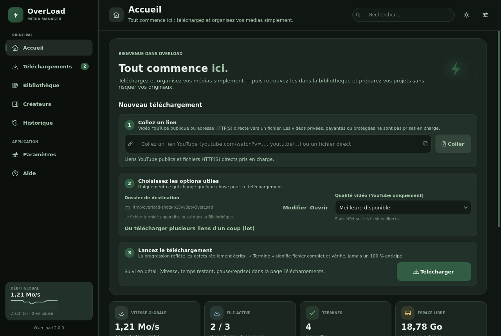
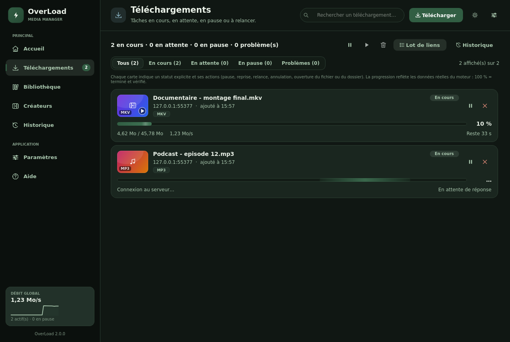
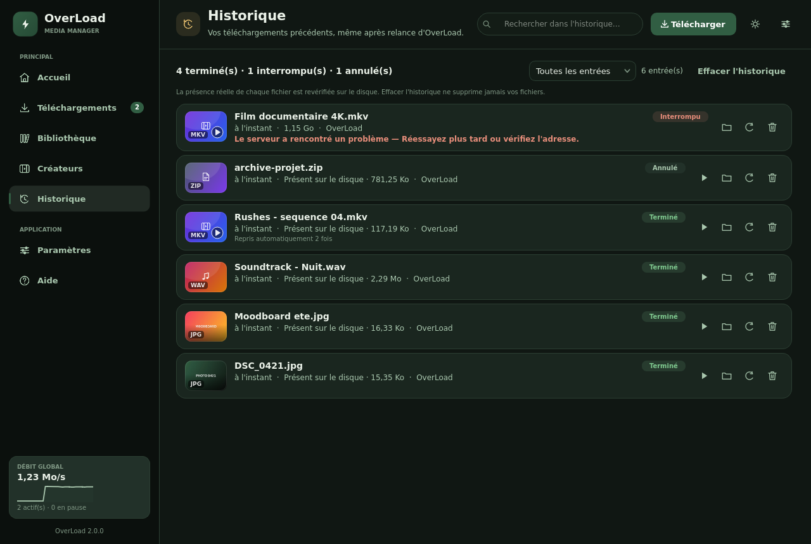
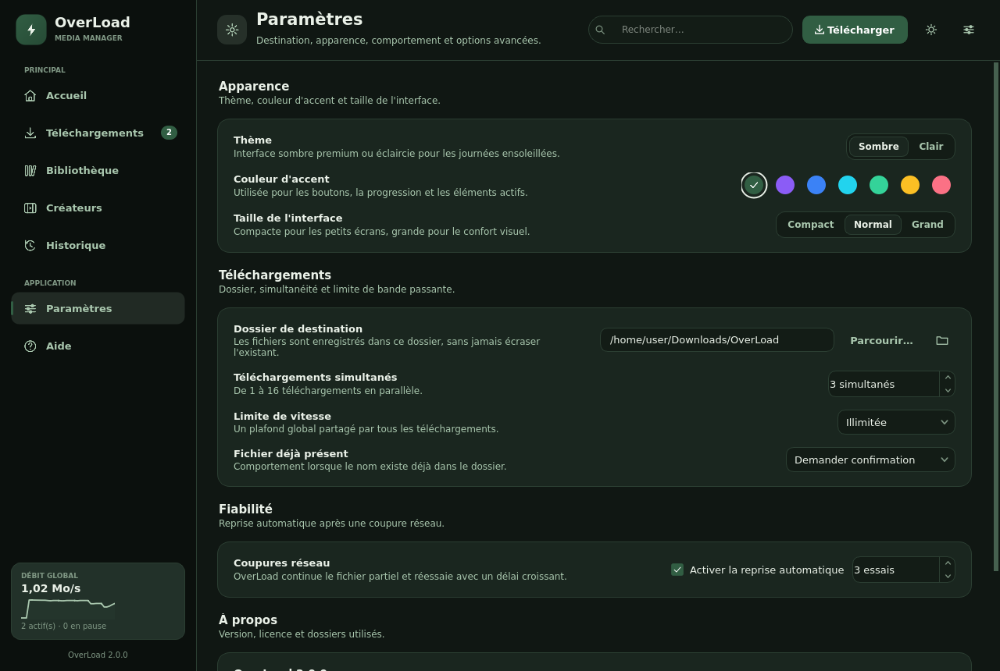
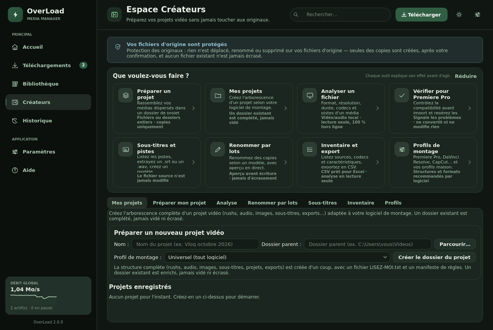
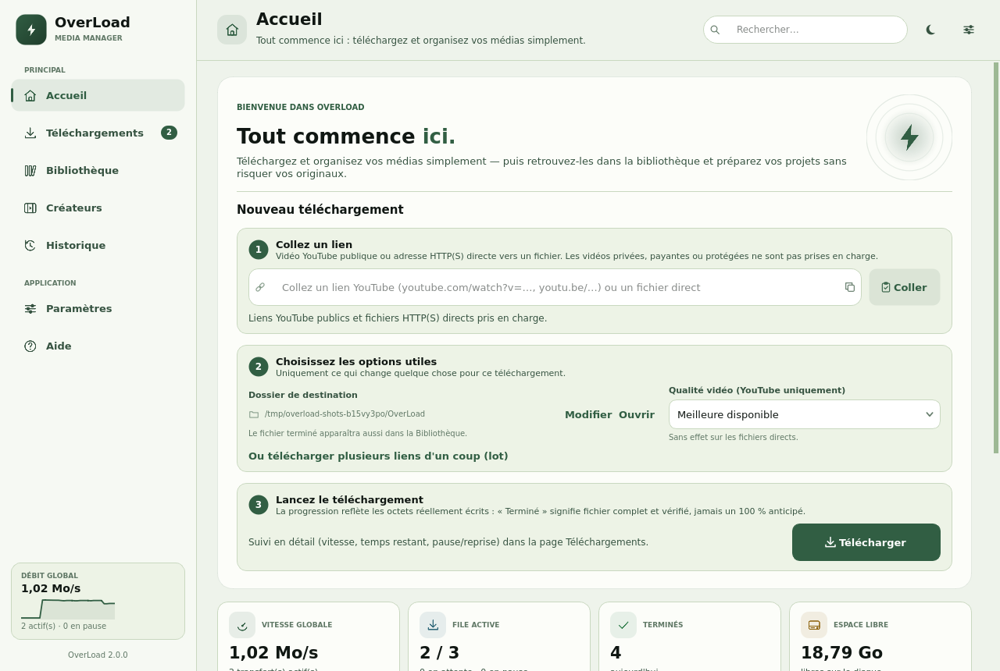

# OverLoad — identité visuelle et interface (v1.3 « OverX Forest »)

Cette page documente le système de design de l'application native `OverLoad.exe`
(PySide6 / Qt Widgets). Les captures sont générées automatiquement par
`python scripts/render_screenshots.py` et servent de référence pour toute
évolution future. ⚠️ Les captures ci-dessous montrent encore la structure
v1.1 (ancienne palette) : à régénérer sous Windows avec la palette OverX
Forest de la v1.3 (`python scripts/render_screenshots.py`).



---

## 1. Principes

1. **Application, pas outil.** Une navigation latérale stable, une barre
   supérieure avec recherche, des cartes aérées et une hiérarchie typographique
   claire donnent l'impression d'un vrai logiciel Windows.
2. **Le calme avant l'information.** Fond très sombre, surfaces légèrement plus
   claires, une seule couleur d'accent qui signale les actions et la progression.
3. **Aucune ambiguïté.** Chaque état possède un libellé humain, une couleur et,
   en cas de problème, une explication en français avec une action concrète.
4. **Tout est vivant.** Les barres de progression s'animent, les pages
   apparaissent en fondu, les survols réagissent, mais rien ne clignote.

## 2. Palette « OverX Forest »

Depuis la v1.3, OverLoad adopte l'identité **OverX Forest** (forêt de nuit) :
naturelle, profonde et premium — aucun vert fluo « gaming ». On privilégie le
vert sapin et le charbon, le vert mousse sert aux boutons et éléments actifs,
le vert sauge aux détails et au texte secondaire.

| Rôle | Sombre | Clair |
| --- | --- | --- |
| Fond (canvas) — vert sapin | `#14251B` | `#EDF2EA` |
| Barre latérale | `#0E1B13` | `#F7FAF3` |
| Cartes / surfaces — charbon | `#202722` | `#FCFDF9` |
| Surfaces secondaires | `#28312B` | `#EEF4E9` |
| Champs de saisie | `#16241B` | `#FFFFFF` |
| Bordures | `#2D3D33` | `#CFDCC8` |
| Texte principal — crème naturel | `#E8EDE5` | `#14251B` |
| Texte secondaire — vert sauge | `#A8BFA5` | `#3F5747` |
| Accent par défaut « Forêt » | `#52765B` (mousse) | `#244A35` (forêt) |
| Information | `#8FB8C4` | `#2F6B7A` |
| Succès | `#86B98A` | `#2E7D4F` |
| Avertissement | `#D9B36A` | `#96690F` |
| Erreur | `#E38B7D` | `#B23A2C` |

Références OverX Forest : sapin `#14251B`, forêt `#244A35`, mousse `#52765B`,
sauge `#A8BFA5`, crème `#E8EDE5`, charbon `#202722` (constantes `FOREST_*` dans
`src/overload/ui/theme.py`).

Accents disponibles : **forêt (défaut)**, violet, bleu électrique, cyan,
émeraude, ambre, rose. Le socle sapin/charbon reste commun à tous les accents.
Ils sont définis une seule fois dans `src/overload/ui/theme.py` et persistés
dans `settings.json` (clé `accent`). Migration unique (schéma 3) : un ancien
réglage resté sur `violet` — l'ancien défaut — bascule sur `forest` ; un violet
choisi explicitement après la migration est conservé.

## 3. Typographie et espacements

- **Titres et texte** : Manrope / Inter si installées (signature OverX), sinon
  Segoe UI Variable (Display/Text), Segoe UI, Arial. Texte 13 px par défaut.
- **Chiffres** : alignement tabulaire pour toutes les métriques.
- **Échelle d'interface** : Compact (0,92), Normal (1,0), Grand (1,12). Toutes
  les tailles de la feuille QSS et des composants dessinés sont multipliées par
  ce facteur.
- **Rayons** : 20 px (carte héro), 16 px (panneaux), 15 px (cartes), 10 px
  (champs, boutons), 8 px (pilules d'état).
- **Espacements** : multiples de 4, marges de page 26 px, gouttières 8 à 16 px.

## 4. Structure de l'interface

```
┌──────────────┬────────────────────────────────────────────────────────┐
│ Logo OverLoad│  Accueil · sous-titre      [recherche]  [⬇] [☀] [⚙]   │
│ ─────────────├────────────────────────────────────────────────────────┤
│ PRINCIPAL    │  Carte héro : champ de lien + bouton Télécharger       │
│  Accueil     │  4 cartes de statistiques (vitesse, file, terminés,    │
│  Télécharg…  │  espace disque)                                        │
│  Créateurs   │  Téléchargements récents        File d'attente         │
│ OUTILS       │                                 + carte Créateurs      │
│  Analyse     │                                                        │
│  Paramètres  │                                                        │
│ ─────────────│                                                        │
│ Débit global │                                                        │
│ version 1.1  │                                                        │
└──────────────┴────────────────────────────────────────────────────────┘
```

Sous 1160 px, la barre latérale se replie automatiquement en rail d'icônes de
72 px ; sous 900 px de contenu, les cartes de statistiques passent de 4 à 2
colonnes et l'illustration du héro est masquée.

### Accueil


- Champ de lien collable (Ctrl+V), validation en direct : le champ passe au
  vert avec le nom du fichier détecté, à l'ambre si le fichier existe déjà, au
  rouge avec l'explication si le lien est refusé.
- Bouton **Télécharger** principal à côté du champ, lien secondaire pour un lot
  de liens, dossier de destination visible et modifiable en un clic.
- Quatre indicateurs : débit global, file active, terminés du jour, espace
  disque libre.
- **Téléchargements récents** avec vignettes réelles (images et premières
  images de vidéos extraites par FFmpeg en arrière-plan).
- **File d'attente** compacte avec barre de progression par tâche.

### Téléchargements



- Sélecteur segmenté *Téléchargements / Historique*.
- Filtres avec compteurs : Tous, En cours, En attente, En pause, Problèmes.
- Chaque carte affiche : vignette, nom, hôte, heure d'ajout, badge d'état,
  format, barre de progression animée, pourcentage, taille, vitesse, temps
  restant et actions contextuelles (pause, reprendre, relancer, annuler,
  ouvrir le dossier, retirer).

### Historique



- Recherche globale (barre supérieure) + filtre par statut.
- Présence réelle du fichier sur le disque vérifiée à chaque affichage.
- Erreurs reformulées en clair, avec bouton *Que faire ?*.

### Paramètres



- Thème sombre / clair, sept accents (forêt par défaut), trois tailles d'interface, appliqués
  instantanément et mémorisés.
- Dossier de destination, simultanéité (1 à 16), limite de débit, politique de
  doublons, reprise automatique et nombre d'essais.
- Version, licence et accès direct au dossier de données.

### Espace Créateurs



- Bandeau permanent rappelant que les fichiers d'origine ne sont jamais
  modifiés, déplacés ni supprimés.
- Onglets : Mes projets, Préparer mon projet, Renommer par lots, Sous-titres et
  pistes, Inventaire et export, Profils de montage — sans emoji, avec des
  libellés lisibles et des contrôles cohérents avec le reste de l'application.

### Thème clair



Le thème clair conserve la même structure et la même hiérarchie ; les surfaces
deviennent blanches, les bordures plus douces et les textes secondaires plus
contrastés pour rester lisibles.

## 5. États visuels des téléchargements

| État | Badge | Couleur | Barre |
| --- | --- | --- | --- |
| En attente | « En attente » | gris | vide |
| En cours | « En cours » | accent | progression + reflet animé |
| En pause | « En pause » | information | progression figée |
| Vérification | « Vérification » | avertissement | progression |
| Terminé | « Terminé » | succès | complète |
| Interrompu | « Interrompu » | erreur | progression conservée + encart explicatif |
| Nouvelle tentative | « Nouvelle tentative n/N » | avertissement | progression conservée |
| Annulé | « Annulé » | neutre | vide |

Aucun état n'affiche plus le mot « Échec » seul : `overload/ui/failure_text.py`
traduit les erreurs techniques (HTTP 401/403/404/429/5xx, DNS, TLS, délai,
connexion coupée, disque plein, permissions, redirections, doublons…) en titre,
cause probable et action recommandée, tout en conservant le détail technique
dans la boîte de dialogue.

## 6. Animations

- Transition de page : fondu de 170 ms (`QEasingCurve.OutCubic`).
- Barre de progression : interpolation de 360 ms vers la nouvelle valeur.
- Reflet animé sur les barres en cours de téléchargement (33 ms).
- Notifications : apparition/disparition en fondu, 2,8 s à l'écran.
- Survols instantanés (aucune animation de couleur superflue).

Toutes les animations sont désactivées naturellement lorsque la fenêtre n'est
pas visible (Qt suspend les timers des widgets masqués).

## 7. Accessibilité et confort

- Contrastes vérifiés sur les deux thèmes (texte principal ≥ 7:1, secondaire ≥
  4,5:1 sur les surfaces).
- Zones cliquables de 28 à 48 px, info-bulles sur toutes les actions icônes.
- Raccourcis : `Ctrl+F` (recherche), `Ctrl+L` (coller un lien), `Ctrl+V` sur
  l'accueil (presse-papiers).
- Les textes longs sont abrégés au milieu avec info-bulle complète, jamais
  tronqués brutalement.
- Libellés d'état et messages d'erreur en français, sans jargon réseau brut.

## 8. Organisation du code

| Fichier | Rôle |
| --- | --- |
| `ui/theme.py` | jetons de couleur, palettes, QSS complet, assets des contrôles natifs |
| `ui/icons.py` | jeu d'icônes vectorielles dessinées avec QPainter (aucune ressource externe) |
| `ui/components.py` | cartes, barres de progression, vignettes, navigation, états vides, notifications |
| `ui/window.py` | fenêtre principale, pages Accueil / Téléchargements / Paramètres, navigation |
| `ui/failure_text.py` | traduction des erreurs en explications utilisateur |
| `ui/creators.py` | onglet Créateurs (logique inchangée, présentation harmonisée) |
| `ui/filedialogs.py` | sélecteurs de fichiers : dossier de départ déterministe (champ courant → dernier dossier choisi → destination → `~/Downloads`), jamais un emplacement « au hasard » |
| `ui/analyzer.py` | analyse multimédia locale |
| `settings/store.py` | persistance thème, accent et taille d'interface |

Les captures de ce document sont régénérables et versionnées dans
`docs/design/`.
